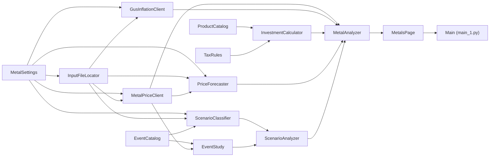

# Metale szlachetne — ile da zakup złota, srebra lub platyny?

Interaktywny kalkulator dla osoby prywatnej w Polsce, która zastanawia się nad kupnem **fizycznego metalu
inwestycyjnego** (monety bulionowe, sztabki). Dla wybranego produktu, kwoty i horyzontu sprzedaży liczy,
ile pieniędzy dostaniesz **na rękę** i ile to będzie warte **w dzisiejszych złotych** (po inflacji),
w pięciu wariantach prognozy — od pesymistycznego do optymistycznego. Dodatkowo pozwala opisać własnymi
słowami wydarzenie (np. „wybuch wojny na Bliskim Wschodzie”, „Fed obniża stopy”) i sprawdzić, jak
podobne wydarzenia z historii wpływały na ceny metali.

Projekt jest zbudowany w CatNip — wizualnym edytorze Pythona opartym na
blokach. Każdy blok to jedna klasa w osobnym pliku `.py` z własną stroną dokumentacji `.md`.

> [!WARNING]
> **To jest projekt poglądowy (edukacyjny), a nie porada inwestycyjna.**
> Wyniki są szacunkami modeli statystycznych i AI na podstawie danych historycznych; nie są
> rekomendacją kupna ani sprzedaży jakiegokolwiek aktywa w rozumieniu przepisów o obrocie
> instrumentami finansowymi. Ceny metali mogą spadać, prognozy bywają błędne, a marże dealerów,
> stawki podatku i przepisy mogą się zmienić. Przed decyzją sprawdź aktualne cenniki dealerów
> i przepisy podatkowe, a w razie wątpliwości skonsultuj się z licencjonowanym doradcą.
> Autor nie ponosi odpowiedzialności za decyzje podjęte na podstawie wyników programu.

## Co pokazuje

- **Ceny spot** złota, srebra i platyny w zł/oz (Yahoo Finance: kontrakty COMEX/NYMEX × kurs USD/PLN).
- **Zakup produktu** — ile całych sztuk kupisz za podaną kwotę, po cenie dealera (spot × marża × VAT).
- **Wynik po N miesiącach** — kwota ze skupu, zysk, podatek (fizyczny metal: PIT tylko przy sprzedaży
  przed upływem 6 miesięcy; dla porównania podatek Belki 19%) i wartość realna po inflacji GUS.
- **Prognoza cen** — model [Chronos-2](https://huggingface.co/amazon/chronos-2) (kwantyle 10/24/50/76/90%);
  gdy model się nie wczyta, zapasowy bootstrap historyczny.
- **Metale a inflacja** — historia cen w dzisiejszych złotych.
- **Porównanie wszystkich produktów** z katalogu dla tych samych parametrów.
- **Analiza scenariuszowa** — lokalny, wielojęzyczny model NLI
  ([mDeBERTa-v3 XNLI](https://huggingface.co/MoritzLaurer/mDeBERTa-v3-base-xnli-multilingual-nli-2mil7))
  rozpoznaje rodzaj opisanego wydarzenia, a wielkość wpływu pochodzi z badania reakcji cen na ok. 65
  prawdziwych wydarzeń od 2004 r. (event study). Bez modelu — rozpoznawanie po słowach kluczowych.

## Wymagania

- **Python 3.10 lub 3.11** (Chronos-2 i aktualny PyTorch nie działają na starszych wersjach).
- Pakiety z [`requirements.txt`](requirements.txt): `pandas`, `numpy`, `matplotlib`, `yfinance`, `torch`,
  `chronos-forecasting` (≥ 2.0), `transformers`, `sentencepiece`, `protobuf`.
- **Dostęp do internetu** przy pierwszym uruchomieniu: notowania (Yahoo Finance), inflacja (GUS)
  i wagi modeli z Hugging Face (łącznie ok. 1,5 GB, pobierane raz do folderu `models/`).
- **CatNip** — do wyświetlenia interaktywnej strony z wynikami.
- Opcjonalnie karta NVIDIA z CUDA — modele same jej użyją; na CPU wszystko też działa, tylko wolniej.

## Instalacja

```bash
git clone https://github.com/ATSP5/CatNipMetaleSzlachetne.git
cd CatNipMetaleSzlachetne

python -m venv .venv
# Windows:
.venv\Scripts\activate
# Linux / macOS:
source .venv/bin/activate

pip install -r requirements.txt
```

Na komputerze z kartą NVIDIA warto najpierw zainstalować `torch` w wersji z CUDA według instrukcji
na [pytorch.org](https://pytorch.org/get-started/locally/), a dopiero potem `requirements.txt`.

## Uruchomienie

### W CatNip (zalecane)

1. Otwórz `MetaleSzlachetne.catnip` w CatNip.
2. Wybierz środowisko Pythona z zainstalowanymi pakietami (venv 3.10/3.11 albo Docker).
3. Uruchom przepływ (Run). Strona z wynikami pojawi się w zakładce **Output** i reaguje na każdą
   zmianę kontrolek (metal, produkt, kwota, horyzont, marża, skup, inflacja, opis wydarzenia).

Pierwsze uruchomienie trwa dłużej — pobierane są dane i wagi modeli. Kolejne korzystają z kopii
w `output/` i `models/`.

### Bez CatNip

```bash
python main_1.py
```

Przepływ policzy się w całości i wypisze w konsoli ceny spot oraz porównanie produktów dla 20 000 zł
i 24 miesięcy. Interaktywną stronę wyświetla jednak tylko Run Engine CatNip — poza nim zostanie
wypisany jedynie komunikat, że strony nie ma gdzie pokazać.

## Struktura projektu

Przepływ danych (GitHub wyświetla go jako diagram):



### Bloki, które wykonują pracę

| Blok | Do czego służy |
|---|---|
| `MetalSettings` | Wszystkie ustawienia analizy: początek historii, maksymalny horyzont prognozy, modele AI, liczba ścieżek bootstrapu, ważność kopii cen, foldery. |
| `InputFileLocator` | Znajduje folder projektu (lokalnie lub `/app` w Dockerze) i tworzy w nim `output/` oraz `models/`. |
| `MetalPriceClient` | Pobiera dzienne ceny złota, srebra, platyny i kurs USD/PLN z Yahoo Finance; przelicza na zł/oz i zapisuje kopię. |
| `GusInflationClient` | Pobiera miesięczną inflację CPI z GUS (CSV + API Dziedzinowej Bazy Wiedzy) z kopią na dobę. |
| `ProductCatalog` | Lista typowych monet i sztabek dostępnych w Polsce z wagą, VAT, marżą dealera i dyskontem skupu. |
| `TaxRules` | Polskie zasady opodatkowania sprzedaży fizycznego metalu (PIT do 6 miesięcy) i porównawczo podatek Belki. |
| `InvestmentCalculator` | Rachunek „cena w dniu sprzedaży → kwota na rękę → wartość w dzisiejszych złotych”. |
| `PriceForecaster` | Prognoza cen na `max_forecast_months` miesięcy: Chronos-2, a zapasowo bootstrap historyczny. |
| `EventCatalog` | 11 rodzajów wydarzeń rynkowych i ok. 65 historycznych przykładów od 2004 r. |
| `EventStudy` | Mierzy rzeczywistą reakcję cen metali na wydarzenia z katalogu (+1 tydz., +1 i +3 mies.). |
| `ScenarioClassifier` | Lokalny model NLI rozpoznający rodzaj wydarzenia opisanego przez użytkownika. |
| `ScenarioAnalyzer` | Łączy rozpoznanie z event study w przewidywaną zmianę cen dla scenariusza. |
| `MetalAnalyzer` | Serce obliczeń: zamienia parametry strony w gotowe wyniki, tabele i wykresy. |
| `MetalsPage` | Interaktywna strona raportu (sam widok, bez obliczeń). |
| `Main` | Punkt wejścia; z niego CatNip generuje `main_1.py`. |

### Rekordy danych (`@dataclass`)

| Blok | Co przechowuje |
|---|---|
| `MetalPriceHistory` | Dzienne ceny metali w zł/oz i kurs USD/PLN. |
| `CpiReading`, `CpiHistory` | Odczyt inflacji GUS za miesiąc i cała ich historia. |
| `MetalProduct` | Produkt (moneta/sztabka) z wagą, VAT, marżą i wzorami cen zakupu i skupu. |
| `MetalForecast` | Prognoza ceny jednego metalu jako kwantyle na kolejne miesiące. |
| `EventCategory` | Rodzaj wydarzenia z opisem, słowami kluczowymi i datami przykładów. |
| `ScenarioResult` | Przewidywany wpływ scenariusza na ceny metali. |
| `MetalResult` | Komplet tabel i serii wykresów dla jednego zestawu parametrów strony. |

Każdy blok ma swoją szczegółową dokumentację w pliku `<NazwaBloku>.md` — parametry, dozwolone zakresy
i wpływ na wynik.

### Pliki i foldery

| Ścieżka | Opis | W repozytorium |
|---|---|---|
| `MetaleSzlachetne.catnip` | Projekt CatNip (graf bloków). | tak |
| `*.py`, `*.md` | Kod i dokumentacja bloków; `main_1.py` — wygenerowany punkt wejścia. | tak |
| `requirements.txt` | Zależności Pythona. | tak |
| `output/` | Kopie pobranych danych (`metal_prices.csv`, `gus_cpi.json`), tworzone przy uruchomieniu. | nie |
| `models/` | Pobrane wagi modeli z Hugging Face (ok. 1,5 GB). | nie |

## Konfiguracja

Parametry analizy ustawia się w inicjalizatorze bloku **`MetalSettings`** (w CatNip albo w
`MetalSettings.py`); zmiana wymaga ponownego uruchomienia:

| Parametr | Domyślnie | Zakres | Znaczenie |
|---|---|---|---|
| `history_from` | `2004-01-01` | nie wcześniej niż 2004-01-01 | Początek historii cen. |
| `max_forecast_months` | `120` | 12–240 | Najdłuższy horyzont prognozy (górna granica suwaka). |
| `forecast_model` | `amazon/chronos-2` | model Chronos-2 | Model prognozy cen. |
| `scenario_model` | `MoritzLaurer/mDeBERTa-v3-base-xnli-multilingual-nli-2mil7` | model zero-shot z HF | Model rozpoznający wydarzenia. |
| `bootstrap_paths` | `4000` | ≥ 200 | Liczba ścieżek prognozy zapasowej. |
| `seed` | `2026` | liczba całkowita | Ziarno losowania bootstrapu. |
| `price_cache_hours` | `12` | ≥ 0 | Jak długo kopia cen jest uważana za świeżą (0 = zawsze pobieraj). |
| `model_cache` | `models` | nazwa folderu | Gdzie trzymać wagi modeli. |
| `cpi_history_from_year` | `2004` | ≤ rok z `history_from` | Od którego roku pobierać inflację. |

Marże dealerów i dyskonta skupu w `ProductCatalog` są orientacyjne (stan: październik 2026) —
na stronie można je zmienić suwakami.

## Źródła danych

- **Yahoo Finance** (przez `yfinance`) — notowania GC=F, SI=F, PL=F i kurs PLN=X.
- **GUS** — wskaźniki cen towarów i usług konsumpcyjnych (CSV oraz API DBW).
- **Hugging Face** — wagi modeli `amazon/chronos-2` i `MoritzLaurer/mDeBERTa-v3-base-xnli-multilingual-nli-2mil7`.

Dane pochodzą z darmowych, publicznych źródeł i mogą zawierać opóźnienia lub błędy. Korzystając z nich,
przestrzegaj warunków ich udostępniania.

## Licencja

Licencja nie została jeszcze wybrana — do czasu dodania pliku `LICENSE` wszystkie prawa zastrzeżone.
Modele i dane zewnętrzne podlegają licencjom ich autorów.

## Zastrzeżenie

Projekt ma charakter wyłącznie **poglądowy i edukacyjny**. Nie stanowi porady inwestycyjnej, podatkowej
ani prawnej, ani rekomendacji w rozumieniu przepisów o obrocie instrumentami finansowymi. Inwestowanie
w metale szlachetne wiąże się z ryzykiem utraty części kapitału. Wszelkie decyzje podejmujesz na własną
odpowiedzialność.
